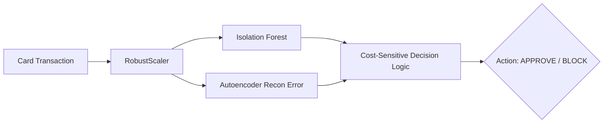

# Credit Card Fraud Detection & Unsupervised Anomaly Engine


Real-time transaction fraud screening engine designed for extreme class skew, combining statistical isolation trees with deep autoencoder reconstruction error.

## System Workflow


## Running the Microservice
```bash
uvicorn src.service.alert_service:app --reload
```
